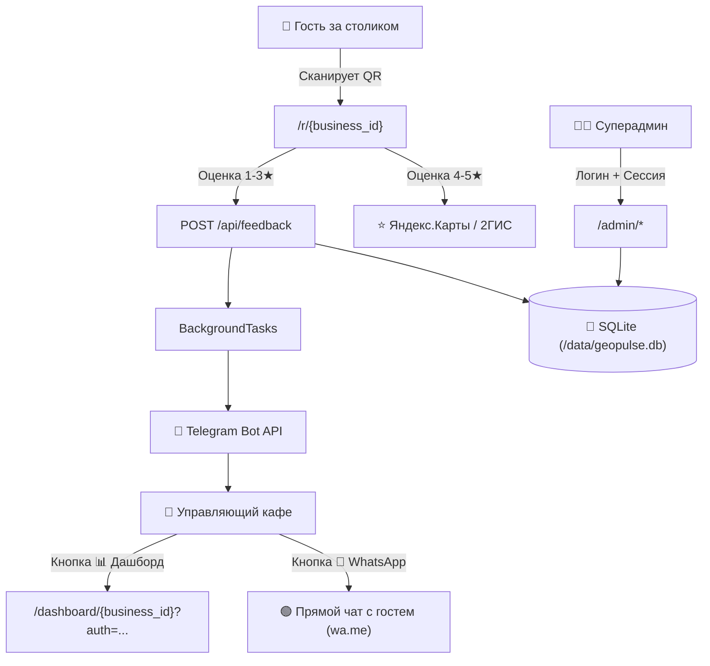

# GeoPulse — Архитектура и Структура Проекта (Project Overview)

> **Дата аудита:** 24 октября 2026 г.  
> **Статус:** Актуальное производственное состояние  
> **Инфраструктура:** Amvera Cloud (Production: `https://pulse-geo.site`), GitHub (`origin/main`)

---

## 1. Назначение Проекта

**GeoPulse** — это многопользовательская (Multi-Tenant) B2B SaaS-платформа для ресторанов, кафе и заведений сферы услуг, предназначенная для:
1. **Защиты репутации на геосервисах:** Перехват недовольных гостей (оценки 1–3★) через QR-коды на столах с моментальной доставкой жалобы и контактов гостя в Telegram управляющего за 1 секунду.
2. **Накрутки естественного органического рейтинга:** Перенаправление довольных гостей (оценки 4–5★) на страницу отзывов заведения в Яндекс.Картах и 2ГИС.
3. **Автоматизации коммуникации:** Прямая кнопка связи с гостем в WhatsApp в 1 клик с предзаполненным вежливым шаблоном извинений.
4. **Печатных материалов:** Встроенная интерактивная Дизайн-студия с 12 стилями тейбл-тентов, генерацией индивидуальных QR-кодов для каждого стола и режимом печати «Домик» (двусторонняя развертка без покупки пластиковых подставок).
5. **Аналитики и CRM:** Личный защищенный дашборд заведения (расчет индекса лояльности NPS, экспорт отзывов в Excel с UTF-8 BOM, суточные Telegram-дайджесты).

---

## 2. Фактический Стек Технологий

| Компонент | Технология | Версия / Особенности |
|---|---|---|
| **Язык разработки** | Python | 3.12 (Amvera Docker) / 3.13 (Local Runtime) |
| **Backend Framework** | FastAPI + Starlette | 0.115.0+ (Асинхронный ASGI-сервер) |
| **Веб-сервер ASGI** | Uvicorn | 0.30.0+ |
| **База данных** | SQLite 3 | WAL-режим, Foreign Keys ON, busy_timeout 5000, хранилище `/data` |
| **Шаблонизатор** | Jinja2 | 3.1.4, автоэкранирование HTML по умолчанию |
| **QR-генерация** | qrcode[pil] + Pillow | 8.0+, генерация градиентных модулей + In-Memory RAM Cache |
| **HTTP-клиент** | HTTPX | 0.27.0+ (Асинхронный async client с таймаутами) |
| **Стилизация** | TailwindCSS + Vanilla CSS | CDN Runtime, кастомные темы, CSS `@media print` |
| **Telegram Bot** | Telegram Bot API | Long Polling в `asyncio.create_task` внутри `lifespan` FastAPI |
| **Платёжный шлюз** | ЮKassa SDK Ready + Sandbox | Эмуляция оплат + webhook обработчик с HMAC |
| **Хостинг и PaaS** | Amvera Cloud (РФ, Москва) | Envoy Reverse-Proxy, Docker, Persistent Volume `/data` |

---

## 3. Файловая Структура Репозитория

```
projectveka/
├── .env                           # Локальные переменные окружения (секреты, токены)
├── .env.example                   # Шаблон конфигурации для развертывания
├── .gitignore                     # Исключения Git (__pycache__, *.db, logs)
├── amvera.yml                     # Манифест сборки и деплоя для платформы Amvera
├── Caddyfile                      # Альтернативная конфигурация reverse-proxy с SSL
├── Dockerfile                     # Мультистейдж контейнер с непривилегированным appuser
├── geopulse.db                    # База данных SQLite (чистый эталонный слепок)
├── requirements.txt               # Зависимости Python
├── run.py                         # Локальный скрипт запуска с баннером и проверкой порта
├── test_audit_suite.py            # Полный автотест-сьют (12 комплексных сценариев)
│
├── app/                           # Исходный код ядра платформы
│   ├── admin.py                   # Панель суперадминистратора (/admin, управление точками, лидами)
│   ├── ai_assistant.py            # Интеллектуальный генератор шаблонов ответов гостям
│   ├── bot.py                     # Telegram-бот (обработка /start, алерты, WhatsApp deep-links)
│   ├── config.py                  # Централизованная конфигурация и fallback считывание .env
│   ├── database.py                # Слой данных SQLite: миграции, транзакции, NPS, выгрузки
│   ├── main.py                    # Главное FastAPI приложение, lifespan, QR-кэш, роутер
│   ├── payments.py                # Логика тарифов, генерация счетов, проверка ЮKassa
│   │
│   ├── static/                    # Статические ассеты
│   │   ├── favicon.ico / .png     # Фавиконка платформы
│   │   ├── logo.svg / logo.png    # Логотип GeoPulse
│   │   └── og-preview.png         # OpenGraph баннер для социальных сетей и мессенджеров
│   │
│   └── templates/                 # 21 HTML-шаблон (Jinja2)
│       ├── index.html             # Главный конверсионный SaaS-лендинг
│       ├── pitch.html / offer     # Коммерческое предложение и оферта
│       ├── review.html            # Экран гостя для выставления оценки (QR-страница)
│       ├── dashboard.html         # Личный дашборд директора точки
│       ├── dashboard_lock.html    # Экран ввода кода доступа к дашборду
│       ├── table_tent_bulk.html   # Дизайн-студия (12 стилей, режим «Домик», раскладка А4)
│       ├── sales_kit.html         # Комплект для B2B продаж и скрипты переговоров
│       ├── pay_sandbox.html       # Платежный шлюз (песочница / счета)
│       ├── pay_success.html       # Экран подтверждения активации подписки
│       └── admin_*.html           # 7 шаблонов админ-панели (управление, аналитика, CSV)
│
└── audit/                         # Артефакты и отчеты полного аудита платформы
```

---

## 4. Карта Архитектуры и Взаимосвязей


